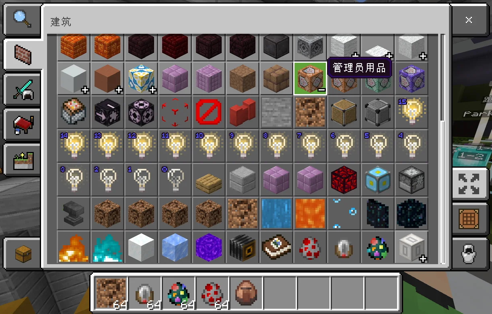
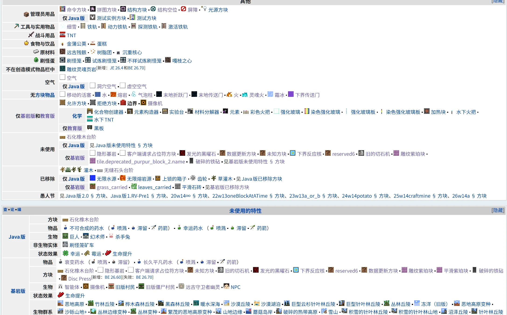
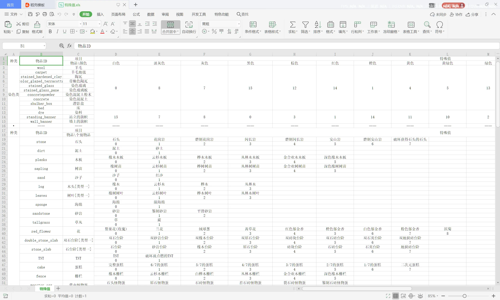

# 管理员用品

此条目是对标Java版的“管理员用品”这一个分类，通过基岩版物品组的功能实现的“管理员用品”物品组。安装此物品组后，您能直接在创造模式物品栏的“建筑”分类中，找到“管理员用品”物品组



## 介绍

基岩版有许多无法通过创造模式物品栏获取的方块，甚至有一些无法通过`/give`命令获取的隐藏方块。在参考[量筒的函数系统模板](https://yzbwdlt.pages.dev/docs/dev_template/homepage)中的`get_items.mcfunction`后，私认为数量不全而且不太直观。故尝试使用基岩版的物品组功能，最终成功加入命令方块等方块。按照Java版“管理员用品”这一个分类内的方块进行排序，后续是装饰性方块、物品。



后来搜寻wiki查找所有被隐藏的方块，加入了如[“隐形基岩” _（可以与该方块后的实体或方块交互）_](https://zh.minecraft.wiki/w/%E9%9A%90%E5%BD%A2%E5%9F%BA%E5%B2%A9)、[“客户端请求放置方块”_（可以与该方块后的实体或方块交互并且不渲染与其接触的完整方块表面）_](https://zh.minecraft.wiki/w/%E5%AE%A2%E6%88%B7%E7%AB%AF%E8%AF%B7%E6%B1%82%E5%8D%A0%E4%BD%8D%E7%AC%A6%E6%96%B9%E5%9D%97)，因特性与[“屏障方块”](https://zh.minecraft.wiki/w/%E5%B1%8F%E9%9A%9C)和[“边界方块”](https://zh.minecraft.wiki/w/%E8%BE%B9%E7%95%8C)相似，故放在一起。还加入了如[“石化橡木台阶”](https://zh.minecraft.wiki/w/%E7%9F%B3%E5%8C%96%E6%A9%A1%E6%9C%A8%E5%8F%B0%E9%98%B6)、“平滑石头双层台阶”、[“发光的黑曜石”](https://zh.minecraft.wiki/w/%E5%8F%91%E5%85%89%E7%9A%84%E9%BB%91%E6%9B%9C%E7%9F%B3)、[“下界反应核”](https://zh.minecraft.wiki/w/%E4%B8%8B%E7%95%8C%E5%8F%8D%E5%BA%94%E6%A0%B8)、[“旧的切石机”](https://zh.minecraft.wiki/w/%E5%88%87%E7%9F%B3%E6%9C%BA%EF%BC%88MATTIS%EF%BC%89)等因特性更新被隐藏的方块。

:::danger[说明]
由于没有打开教育版的功能，会导致引入教育版方块物品会没有贴图和无法使用，故此物品组不含教育版方块。“摄像机”、“相片簿”、“智能体”等仅展示不能正常使用。

出现打开物品组出现`[Item][warning]-Item item.camera requires either an icon atlas or icon texture.`这个错误信息不影响正常使用
:::

## 实现

配合[译名修正包](https://github.com/ff98sha/mclangcn)效果更佳。如果需要正常显示“管理员用品”名称这个物品组，需要修改`RP/texts/zh_CN.lang`，增加一条

```lang title="RP/texts/zh_CN.lang"
【修改为你的命名空间】:operator_utilities=管理员用品
```

在`BP/item_catalog/crafting_item_catalog.json`中填入以下json。

```json title="BP/item_catalog/crafting_item_catalog.json"
{
  "format_version": "1.21.60【修改为你的客户端版本】",
  "minecraft:crafting_items_catalog": {
    "categories": [
      {
        "category_name": "construction",
        "groups": [
          {
            "group_identifier": {
              "icon": "minecraft:command_block",
              "name": "【修改为你的命名空间】:operator_utilities"
            },
            "items": [
              "minecraft:command_block",
              "minecraft:chain_command_block",
              "minecraft:repeating_command_block",
              "minecraft:command_block_minecart",
              "minecraft:jigsaw",
              "minecraft:structure_block",
              "minecraft:structure_void",
              "minecraft:barrier",
              "minecraft:border_block",
              "minecraft:invisible_bedrock",
              "minecraft:client_request_placeholder_block",
              "minecraft:allow",
              "minecraft:deny",
              "minecraft:light_block_15",
              "minecraft:light_block_14",
              "minecraft:light_block_13",
              "minecraft:light_block_12",
              "minecraft:light_block_11",
              "minecraft:light_block_10",
              "minecraft:light_block_9",
              "minecraft:light_block_8",
              "minecraft:light_block_7",
              "minecraft:light_block_6",
              "minecraft:light_block_5",
              "minecraft:light_block_4",
              "minecraft:light_block_3",
              "minecraft:light_block_2",
              "minecraft:light_block_1",
              "minecraft:light_block_0",
              "minecraft:petrified_oak_slab",
              "minecraft:smooth_stone_double_slab",
              "minecraft:deprecated_purpur_block_1",
              "minecraft:deprecated_purpur_block_2",
              "minecraft:glowingobsidian",
              "minecraft:netherreactor",
              "minecraft:stonecutter",
              "minecraft:deprecated_anvil",
              "minecraft:info_update",
              "minecraft:info_update2",
              "minecraft:reserved6",
              "minecraft:unknown",
              "minecraft:air",
              "minecraft:moving_block",
              "minecraft:water",
              "minecraft:lava",
              "minecraft:bubble_column",
              "minecraft:end_gateway",
              "minecraft:end_portal",
              "minecraft:fire",
              "minecraft:soul_fire",
              "minecraft:powder_snow",
              "minecraft:frosted_ice",
              "minecraft:portal",
              "minecraft:camera",
              "minecraft:portfolio",
              "minecraft:spawn_egg",
              "minecraft:agent_spawn_egg",
              "minecraft:npc_spawn_egg"
            ]
          }
        ]
      }
    ]
  }
}


```

## 下载

您可以下载最简单版本，仅单个行为包，不引入资源包。

其中，物品组的命名为`minecraft:permissions.ability.op`即“管理员命令”。

[](https://pub-9ffbc6f410d4452382ca0b754abeae80.r2.dev/docs/operator_utilities.mcpack)

## 你知道吗

其实早期流传的`特殊值.xls`其实也是o绿叶o整理收集的。



而后随着命令助手的“物品特殊值补充.json”作为拓展包加入xero的命令助手中。
